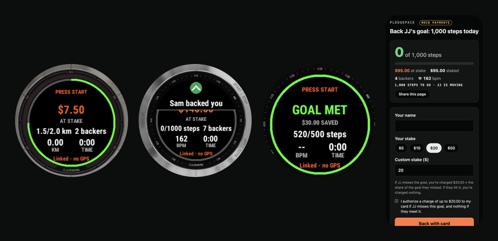

# PledgePace

**2026 Tech Thursday x Garmin Hackathon · JJ's For Shiggles Project**

Put your friends' money where your feet are. PledgePace is a Garmin Connect IQ watch app and a small web service: you set an activity goal, friends back it with a stake, and each backer is charged only for the share of the goal you miss. Hit the goal and nobody pays. Every step you take lowers what your friends stand to lose.



Built around the hackathon brief, *"Build something that would make your own Health & Wellness better"*, with bonus points for every Garmin sensor put to real use.

> **Status:** side project. It runs end to end in the Connect IQ simulator and the browser, with Helcim payments in mock mode. It has not run on a physical watch or against a real Helcim account yet. Details in [What's verified](#whats-verified).

## How it works

1. **Set a goal** on the dashboard (`/organizer`): 8,000 steps today, 20 floors, 150 active minutes or 20 km this week.
2. **Share the pledge link.** Friends pick a stake, tick a box authorizing a charge of up to that amount, and enter a card in Helcim's secure card window. The card is checked with a $0 verify; nothing is charged yet.
3. **Move.** The watch counts progress with its own sensors, shows the money still at stake inside a progress ring, and nudges you: "Sam backed you", "2,000 steps to go", "Goal met!".
4. **Settle.** Each backer is charged *stake × share of the goal missed*. A met goal releases everyone without a charge.

```
pledge page ── POST /api/pledges (consent) ──▶ server ── /helcim-pay/initialize ($0 verify) ──▶ Helcim
   │ HelcimPay.js card window ◀── checkoutToken ──┘
   └─ POST /api/pledges/:id/confirm (signed) ──▶ server checks the hash, keeps only the card token

watch ── POST /api/runs/:id/telemetry {steps, floors, zoneSec, km} ──▶ server ──▶ { at stake, progress, backers }
watch background task, every 5 min ── POST /api/runs/:id/nudge ──▶ server ──▶ { "Sam backed you" }

dashboard ── POST /api/runs/:id/settle ──▶ server ── /payment/purchase per backer (idempotent) ──▶ Helcim
```

## Garmin sensors in real use

| Goal unit | Sensor | Where the watch reads it |
| --- | --- | --- |
| Steps | Accelerometer | `ActivityMonitor.getInfo().steps`, the watch's all-day count |
| Floors | Barometer | `ActivityMonitor.getInfo().floorsClimbed` |
| Active minutes | Heart rate | Seconds at or above the wearer's heart-rate zone 2, taken from their Garmin profile |
| Kilometres | GPS | Distance of the recorded activity |

Sensor goals count from the moment the goal is set and survive the watch's midnight reset. The watch and the pledge page also show live heart rate.

## Features

- **Watch app** (Monkey C, a Connect IQ device app). Money at stake as the hero number, a progress ring on the bezel, GOAL MET with a buzz and a tone, live BPM. START starts, pauses and resumes; BACK asks "Finish run?" and Cancel keeps the run. Built for fēnix 7, fēnix 7 Pro, Forerunner 265 and 965 and Venu 3.
- **Background nudges.** A Connect IQ background task runs every 5 minutes, the shortest interval allowed, and posts real watch notifications through the Notifications API (API 5.1 and later), with an "Open PledgePace?" prompt as the fallback on older watches.
- **Payments through Helcim.** HelcimPay.js $0 verify, saved card tokens, idempotent purchases, response-hash validation, settlement one backer at a time. Card numbers never touch this server. See [docs/helcim.md](docs/helcim.md).
- **Phone-first pledge page.** Pinned "Back with card" button, an explicit consent box stating the most that can be charged, a share button, and Add to Home Screen with its own icon.
- **Fair by design.** Stakes are capped at $500, a goal locks as soon as anyone backs it so terms never change after commitment, and a pledge without consent is refused before Helcim is contacted.
- **Per-km charity mode.** Runners without a goal take classic pledges per kilometre with a cap.
- **No dependencies.** The server is plain Node 20+ with no `npm install`, and 27 tests run with `node --test`.

## Quick start

```bash
cd server
node server.mjs
```

That runs in mock mode: no Helcim account needed, and the page says "Mock payments". Then:

1. Open `http://127.0.0.1:8788/organizer`, pick **Steps**, set a goal of 1000 and your name, and press **Set goal**.
2. Open `http://127.0.0.1:8788` and back the goal once or twice.
3. Simulate a walk from a second terminal:

```bash
SPEED_UP=30 node fake-runner.mjs http://127.0.0.1:8788 <runner-id> --finish-at=1
```

4. Press **Settle now** on the dashboard.

Tests: `cd server && npm test`.

### On a watch (or the simulator)

1. Install the [Connect IQ SDK Manager](https://developer.garmin.com/connect-iq/sdk/), SDK 9.1.0 or later, and the device profiles you need; then VS Code with Garmin's Monkey C extension and a developer key.
2. In `watch/resources/settings/properties.xml` set `serverUrl`, `runnerId` and `relayKey`. Sideloaded apps never receive settings from the phone, so these are built in.
3. Build `watch/` for your device and run it in the simulator, or sideload the `.prg`.

The full simulator demo (driving steps, floors and heart rate, firing a nudge on cue) and its gotchas are in [docs/simulator.md](docs/simulator.md). For phones to reach a server on your laptop, expose it over HTTPS with a tunnel such as `ngrok http 8788`.

## Configuration

Copy `server/.env.example` to `server/.env` and run `node --env-file=.env server.mjs`.

| Variable | Default | Meaning |
| --- | --- | --- |
| `HELCIM_API_TOKEN` | empty (mock mode) | A Helcim **developer test account** token. Never a live one. |
| `RELAY_KEY` | empty | Shared secret for goal setup, watch telemetry, nudges and settlement. Set it whenever the server is reachable from the internet. |
| `DATA_FILE` | `server/data/state.json` | Where goals, pledges and card tokens are saved. |
| `DEFAULT_RUNNER` | the most recent open goal | Which goal a bare pledge link opens. |
| `NUDGE_EVERY_MIN` | 60 | Least time between "steps to go" reminders. |
| `AUTO_SETTLE` | 0 | 1 settles as soon as the watch finishes a run. |
| `PORT`, `HOST` | 8788, 127.0.0.1 | Where the server listens. |

The HTTP API is described in [docs/api.md](docs/api.md).

## Project layout

```
server/   server.mjs (HTTP API and settlement), helcim.mjs (Helcim client), fake-runner.mjs, server.test.mjs
web/      index.html (pledge page), organizer.html (dashboard), manifest and icons
watch/    Monkey C source, resources and manifest
docs/     API, Helcim notes, simulator guide, screenshots
```

## What's verified

- **Server:** 27 tests. They run the real Helcim code path against a fake Helcim API and check URLs, headers and body fields. The money rules were each broken on purpose to confirm a test fails: the per-km cap, the hash check, the no-double-charge guard, the stake share, required consent, the goal lock, sensor counters and nudge de-duplication.
- **Browser:** pledging, consent, settlement and the phone layout, checked at 375px through a public HTTPS tunnel.
- **Connect IQ simulator (SDK 9.1.0, fēnix 7 and 7 Pro):** steps and km goals through to GOAL MET and settlement, heart rate and zone time reaching the server, a background nudge shown as a notification, and recovery from a wrong key or a stopped server.
- **Not verified yet:** a physical watch; a real Helcim test account; nudges while the app is closed (the simulator only fires background events for the running app); a nonzero floors reading; Garmin Connect charting the custom FIT fields of a sideloaded app.

## Hackathon context

PledgePace started as a prep idea for the Tech Thursday x Garmin Hackathon in Calgary on November 14th, 2026, where Garmin Canada and Helcim were among the sponsors. The team built something else on the day, so this carried on as a personal side project.

PledgePace is not affiliated with or endorsed by Garmin or Helcim. Garmin, Connect IQ and fēnix are trademarks of Garmin Ltd. or its subsidiaries; Helcim is a trademark of Helcim Inc.

## License

[Apache License 2.0](LICENSE).
